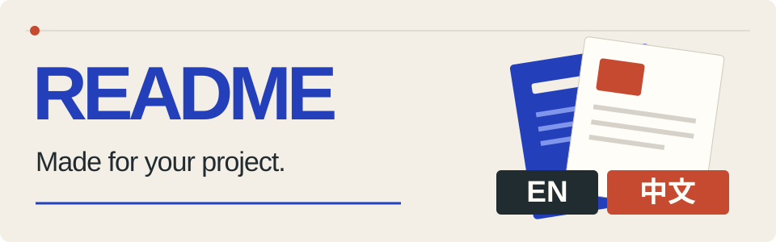

# Yoho Standard README

English · [简体中文](README.zh-CN.md)



**Give your repository an introduction worth reading.**

A Codex skill for accurate project introductions, deliberate visual design, and matching English / 简体中文 READMEs. It starts with your actual repository and shows three visual directions before completing the documents.

[Quick start](#quick-start) · [Workflow](#workflow) · [Helper tools](#helper-tools) · [Verification](#verification)

## Three directions. One choice.

Compare three real first-screen previews, each with a distinct composition, narrative emphasis, and chapter plan. Choose the direction that fits your project; the skill then completes English `README.md`, Chinese `README.zh-CN.md`, and any necessary supporting material.

Your existing READMEs stay in place while you compare. After your choice, the skill proceeds with writing and verification. Both editions retain equivalent facts, prerequisites, commands, parameters, and limitations, with natural prose in each language.

### Five style families

Each run adapts three candidates from these starting points. The default trio includes Centered Brand Hero; you can request a different set.

| Style | First-screen emphasis |
| --- | --- |
| **Centered Brand Hero** | Centered logo → title → slogan → relevant badges/tags → useful links → brief introduction or real demo |
| Engineering Quickstart | A clear task, copyable command or API call, and expected output |
| Product Showcase | An authentic interface or output capture and the user workflow |
| Editorial Overview | A restrained cover, the project's problem, and its approach |
| Workflow Guide | A readable process or architecture diagram and the route to first use |

The introduction can move above the badges when the project's story reads better that way. Centered Brand Hero returns the technical body to left-aligned, readable prose. Logos, badges, and homepage links depend on real assets and evidence; absent elements are omitted. The other candidates vary composition and reading priorities, with the project determining which families fit. See the [style recipes](references/visuals.md) for details.

## Shaped around your project

The reading path follows what a developer needs to understand and try first.

| Project | Useful starting point | Details to cover when relevant |
| --- | --- | --- |
| Library or SDK | A public API call and its result | Installation, errors, compatibility, reference docs |
| CLI | A real command and its output | Flags, configuration, input/output behavior |
| Application | An actual interface and user task | Local setup, environment, persistence, deployment |
| Service | A request/response and its system role | Dependencies, configuration, authentication, limits |
| Skill or developer tool | The task and the artifact it produces | Installation, invocation, workflow, tool requirements |
| Research or data project | The question and a reproducible result | Data access, method, assumptions, reproducibility |

### A consistent content baseline

Every final README covers seven core roles: **Hero/identity, About, Features, Getting started, Usage, Documentation and limitations, and License status**. Headings can be merged or reordered to fit the project. Getting started includes prerequisites, installation or access, required configuration, and a first successful result.

The [editable content template](references/content.md) adapts [Best-README-Template](https://github.com/othneildrew/Best-README-Template). Built with, roadmap, contributing, support, and acknowledgments are added where supported; required notices and credits are always retained. [awesome-readme](https://github.com/matiassingers/awesome-readme) provides additional examples and tools for presentation. The references supply structure and inspiration; project claims come from the target repository.

Existing translations, legal notices, attribution, and useful documentation are preserved. New deep docs and visuals are added only when they help the reader.

## Quick start

### 1. Install in Codex

You need Codex with local skill support and a local checkout of this repository. Cloning requires an account with access to the repository.

```sh
git clone https://github.com/Yohoia/yoho-standard-readme.git
cd yoho-standard-readme
```

From the checkout root, copy the runtime files into your personal skills directory. These POSIX shell commands also update an existing installation:

```sh
readme_skill_dir="${CODEX_HOME:-$HOME/.codex}/skills/yoho-standard-readme"
mkdir -p "$readme_skill_dir/agents" "$readme_skill_dir/references" "$readme_skill_dir/scripts"
cp SKILL.md "$readme_skill_dir/SKILL.md"
cp agents/openai.yaml "$readme_skill_dir/agents/openai.yaml"
cp references/*.md "$readme_skill_dir/references/"
cp scripts/audit_readme.py scripts/preview_readme.mjs "$readme_skill_dir/scripts/"
```

The default destination is `~/.codex/skills/yoho-standard-readme`; `CODEX_HOME` is respected when set. The installation contains seven files: the skill entry point, interface metadata, three references, and two scripts. The same files can be copied manually when a POSIX shell is unavailable.

### 2. Invoke from the target project

Once Codex has loaded the skill, open the repository you want to document and send:

```text
Use $yoho-standard-readme to redesign this project's README.
Show three visual directions with chapter plans first.
After I choose, complete README.md and README.zh-CN.md.
```

The skill investigates the project before proposing a design. Review the three previews, choose a direction, and let it complete the bilingual rewrite. Only missing facts that affect correctness need clarification.

## Workflow

1. **Establish facts.** Read source, configuration, examples, existing docs, and relevant project instructions. Keep an evidence note distinguishing execution, source support, and unresolved claims.
2. **Explore directions.** Create exactly three project-specific first screens and chapter plans, with Markdown sources and rendered previews staged in scratch.
3. **Choose.** Wait for your explicit design choice while preserving the existing READMEs.
4. **Complete both editions.** Write the full introduction, first-use path, limits, and useful links. Add selected assets and deeper docs when needed.
5. **Verify.** Check structure, actual usage, bilingual equivalence, and visual presentation separately. Hand off a concise record of completed checks and concrete gaps.

Rendering and image generation are optional capabilities. When rendering is unavailable, candidates remain inspectable Markdown and are explicitly marked as unrendered. Existing assets, simple SVG, or Markdown can support the final design. Conceptual artwork never serves as evidence of an interface, feature, or benchmark.

## What lands in your repository

```text
your-project/
├── README.md                    English entry point
├── README.zh-CN.md              Simplified Chinese edition
├── docs/                       Existing or necessary deeper material
└── .scratch/readme-previews/    Candidate sources and review assets
```

This layout is illustrative: the skill follows your existing scratch, documentation, and asset conventions. Both READMEs link to one another near the top. Core explanations and commands remain copyable Markdown; published assets use only the selected direction. Other language editions are retained, and affected language switches and documentation links are updated deliberately.

## Helper tools

The skill instructions coordinate the rewrite. The bundled scripts support specific checks; they are not a standalone README generator.

### Structural audit

Requires Python 3 and its standard library; no pip packages. From this skill's checkout:

```sh
python3 scripts/audit_readme.py --repo /path/to/project
```

By default it inspects `README.md` and `README.zh-CN.md`. For an individual document or first-screen candidate:

```sh
python3 scripts/audit_readme.py \
  --repo /path/to/project --single path/to/document.md
```

The JSON report covers local links and fragments, language links, image descriptions, selected incompatible HTML, risky SVG dependencies, and differing runnable examples. Exit `0` means no structural errors, `1` means structural errors, and `2` means an argument or reading failure. Warnings still need review; an exit of `0` does not establish factual accuracy or translation quality.

### Local visual preview

Requires Node.js, `marked`, `sanitize-html`, Playwright, and a working Chromium browser. Use existing tools, or keep extra dependencies in a separate tooling directory.

```sh
node scripts/preview_readme.mjs \
  --repo /path/to/project \
  --out /path/to/project/.scratch/readme-review \
  --module-root /path/to/tooling/node_modules \
  --browser /path/to/chromium \
  README.md README.zh-CN.md
```

`--module-root` can be repeated. Omit it or `--browser` when packages or a Playwright browser already resolve. Each input produces four first-screen PNGs: desktop at 900px and mobile at 360px, in light and dark themes, plus `index.html` and `report.json`.

Exit `0` means ready for visual review, `1` identifies a broken image, page overflow, or empty content, and `2` indicates a runtime failure. Remote resources are blocked and listed as unverified; Mermaid remains unrendered. Captures approximate GitHub's GFM presentation. Inspect the actual images and content below the first screen as well.

See [helper usage and acceptance criteria](references/validation.md) for the full checking boundaries.

## Verification

The [verification record](docs/verification.md) documents 26 auditor CLI tests and representative isolated workflow trials: a CLI, a library with translation migration, an environment with rendering disabled, and document/asset defect repair.

These checks cover observed behavior. They do not prove support for every project type or environment. Recorded tooling includes Python 3.12.10, Marked 17.0.5, sanitize-html 2.18.1, Playwright 1.62.1, and an installed Chromium browser; no minimum Python/Node version policy is declared.

Local previews are not checks of GitHub's live renderer, Camo proxy, or Mermaid runtime. Image generation, remote image/URL checks, and skill discovery in a new Codex session were not part of the recorded acceptance. Structural reports cannot prove claims, execute instructions, or judge bilingual prose.

## Repository guide

| Path | Purpose |
| --- | --- |
| [SKILL.md](SKILL.md) | Main workflow and selection gate |
| [agents/openai.yaml](agents/openai.yaml) | Codex interface metadata and default prompt |
| [references/content.md](references/content.md) | Content structure, evidence, and bilingual decisions |
| [references/visuals.md](references/visuals.md) | Distinct proposals, GitHub-compatible visuals, and asset choices |
| [references/validation.md](references/validation.md) | Helper commands and acceptance boundaries |
| [scripts/](scripts/) | Structural auditor and optional preview helper |
| [tests/test_audit_readme.py](tests/test_audit_readme.py) | Process-level auditor regression tests |

## Development and license

Run the auditor's behavior tests and the preview helper's syntax check from the checkout:

```sh
python3 -m unittest discover -s tests -v
node --check scripts/preview_readme.mjs
```

For changes to the skill's decisions, use an isolated target project and review the actual artifacts as well. The existing tests exercise the auditor; they are not an automated regression suite for complete README redesigns.

This repository currently contains no license file or license declaration. No license permission is implied by this README.
